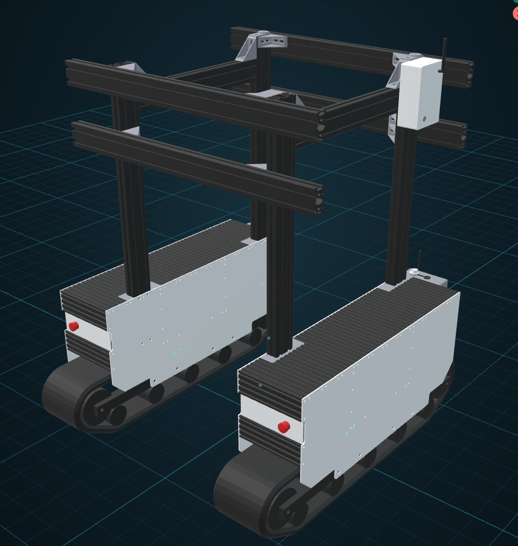

# RTU URDF

Autodiscovery RTU (Robotic Traction Unit) description. Frames follow
REP-103/105: +X forward (the Front_Panel end), +Y left, +Z up, metres.
`base_footprint` sits on the ground, centred between the two track pods.



## Files

| File | What it is |
|---|---|
| `rtu.urdf.xacro` | **Top-level file. Start here.** Includes the three files below, places the two pods, the mast, and the HEAD-lite payload. |
| `rtu_pod.xacro` | `rtu_pod` macro: one track pod (side panels, battery, deck, control box, track/road wheels). Mirror-symmetric, so it's instantiated twice — `side="1"` for left, `side="-1"` for right — rather than hand-duplicated. |
| `rtu_mast.xacro` | `rtu_mast` macro: the 4080-extrusion gantry on top of the pods (uprights, crossbeams, brackets, GPS mounts, electronics box). Not mirror-symmetric, so it's one block, instantiated once. |
| `head_lite.xacro` | `head_lite` macro: the HEAD-lite v3 navigation payload (**placeholder geometry** — boxes/cylinder/sphere, not real meshes). Always included, mounted upside down under `mast_crossbeam_front_lower`. |
| `RTU.urdf` | Flat, fully-expanded URDF — kept for quick viewing without running `xacro`. Does **not** include HEAD-lite. |
| `RTU_headlite.urdf` | `xacro rtu.urdf.xacro` expanded to plain URDF. Regenerate after editing any `.xacro` file (see below) — don't hand-edit it. |
| `meshes/` | One STL per link, named identically to the link (e.g. `right_road_wheel_3.stl`). |

## Editing

Edit the `.xacro` files, never `RTU_headlite.urdf` directly. After changing anything, regenerate and check:

```bash
cd RTU_urdf
xacro rtu.urdf.xacro -o RTU_headlite.urdf
check_urdf RTU_headlite.urdf
```

### What is xacro, and why bother?

`xacro` is a preprocessor for URDF: it's the same XML, plus macros,
properties (named constants), simple math, and `<xacro:include>` to split
one robot across files. `xacro some_file.xacro` expands all of that into
plain URDF, which is what `robot_state_publisher`, RViz, Gazebo, and
`check_urdf` actually read — none of them understand `.xacro` directly.

Here it buys two things:
- **No duplication.** The left and right pods are identical except for a
  mirrored Y offset, so they're written once as the `rtu_pod` macro and
  instantiated twice, instead of keeping 44 duplicated links in sync by
  hand.
- **A real seam for the payload.** `head_lite.xacro` is a self-contained
  macro taking a `parent` link and a mount `origin`. Swapping the
  placeholder boxes for the real HEAD-lite STEP/STL later means replacing
  this file's insides only — `rtu.urdf.xacro` and the pods don't change.

## HEAD-lite payload (placeholder)

`head_lite.xacro` currently uses primitive shapes sized from the product
photos, not real meshes — replace it once CAD is available:

- **Mount:** `head_lite_mount`, parented to `mast_crossbeam_front_lower`,
  centred on the beam, 40 mm below its underside.
- **Orientation:** the enclosure is rolled 180° about X (mounted upside
  down) so the OAK camera on its front face still looks along the pod's
  forward (+X) direction.
- **Frames:** `head_lite_link` (enclosure), `head_lite_top_module` →
  `head_lite_dome` → `gnss_link`, and `oak_link` with
  `oak_{rgb,left,right}_camera_frame` / `..._optical_frame` pairs,
  following the `depthai-ros` naming convention.

Needed to replace the placeholder: the HEAD-lite STEP/STL (ideally the
full sub-assembly including its mounting bracket, exported the same way
as the RTU), the exact OAK camera model (Luxonis publish official
xacro/URDF per model), and the GNSS antenna's phase-centre offset.

## Provenance

Generated from a STEP-to-URDF export (`RTU - Master Assembly.STEP`) that
was upside down, off-centre, and flatly named (`part_42_42`, etc.). See
git history / commit messages for the audit of the original export and
the renaming/reorientation mapping that produced this structure.
